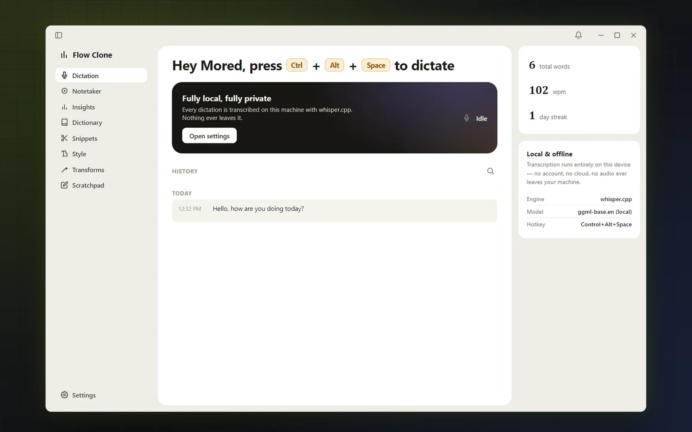
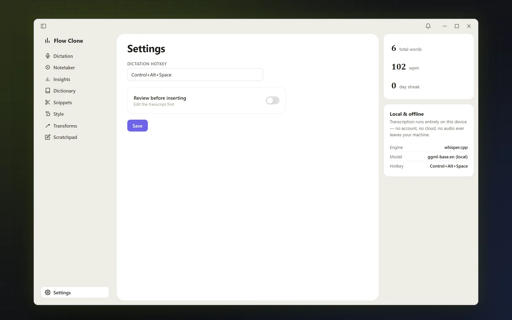
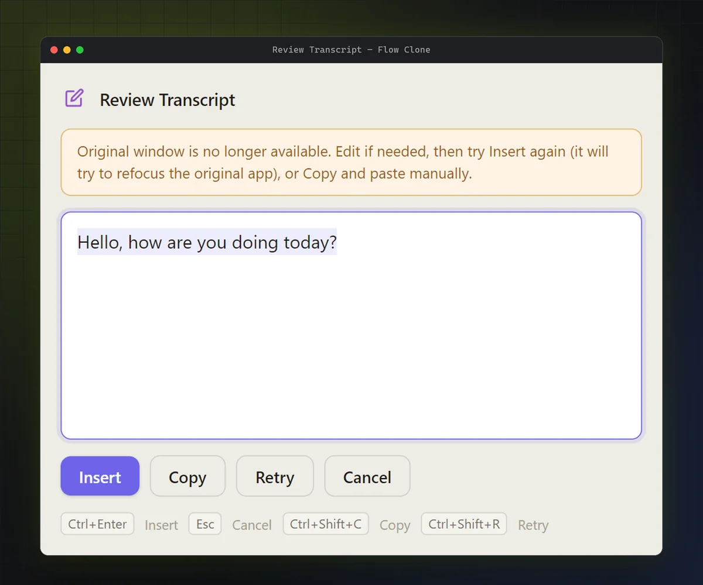

# Local Voice Dictation

A small Windows dictation app I built with Electron. Press a hotkey, talk, press it again, and the text gets pasted into whatever window you were typing in. Speech recognition runs on your own machine with [whisper.cpp](https://github.com/ggml-org/whisper.cpp), so your audio never goes to a cloud service.

It's a personal prototype. The interface is a deliberate design study inspired by [Wispr Flow](https://wisprflow.ai/), but this is an independent project with its own code. It isn't affiliated with Wispr Flow and doesn't try to reproduce how Wispr Flow works internally.



## What it does

- **Dictate anywhere.** Press <kbd>Ctrl</kbd>+<kbd>Alt</kbd>+<kbd>Space</kbd> to start, and press it again to stop. The text is pasted into the window that had focus when you started.
- **Transcribes locally.** It runs `whisper-cli.exe` with the English `ggml-base.en` model. The app itself makes no network requests, and its windows block them with a Content Security Policy.
- **Pastes into the right window.** Before pasting, it brings the original window back to the front and checks that this actually worked. If it didn't, nothing is pasted.
- **Never loses a finished transcript to a failed paste.** If the original window is gone, the text opens in a review window where you can edit, insert, copy or retry. There's also a "Review before inserting" switch if you want to see every transcript first.
- **Shows what it's doing.** A small status pill shows recording, processing, success or error, without stealing focus from the app you're typing in.
- **Keeps a local history.** The last 200 dictations, with total words, words per minute and a daily streak.

| Settings | Review window |
|---|---|
|  |  |

## Getting started

You need **Windows**, a microphone, [Node.js](https://nodejs.org/) and npm. I've been using Node.js 22.

```powershell
git clone https://github.com/muridabuhamed/local-voice-dictation.git
cd local-voice-dictation
npm install
npm run setup
npm start
```

`npm run setup` downloads two things the app needs and skips anything that's already there:

- a prebuilt whisper.cpp CPU build for Windows x64 (about 9 MB) into `bin/whisper/`
- the `ggml-base.en` model (about 148 MB) into `models/`

Neither is checked into the repository. If either is missing, the app tells you so and won't start recording.

## Using it

1. Start the app with `npm start`.
2. Click into the window you want to type in, such as an editor, a chat or a browser field.
3. Press <kbd>Ctrl</kbd>+<kbd>Alt</kbd>+<kbd>Space</kbd>, speak, and press it again when you're done.
4. The text is pasted where your cursor was. If that window has closed in the meantime, the review window opens instead.

You can change the hotkey and switch on "Review before inserting" under **Settings**. If a hotkey can't be registered, the app keeps the previous one.

Settings and history are stored in `%APPDATA%\flow-clone\` (`settings.json` and `history.json`).

## How it works

Everything that touches the operating system lives in Electron's main process.

1. **Hotkey:** a global shortcut starts and stops recording.
2. **Target window:** the app notes which window has focus, using `user32.dll` through short-lived, hidden PowerShell processes. That way I didn't need a native Node module.
3. **Audio:** an `AudioWorklet` collects microphone samples into 4,096-sample chunks and sends them to the main process, which converts them to 16-bit PCM.
4. **Transcription:** when you stop, the audio is written to a temporary WAV file and handed to `whisper-cli.exe`. The temp file is deleted afterwards. Transcription starts after you stop talking; it isn't live.
5. **Insertion:** the app refocuses the original window, checks it's really in front, puts the text on the clipboard, presses <kbd>Ctrl</kbd>+<kbd>V</kbd>, and restores your previous clipboard text.

I wrote up the full story, including the bugs that taught me the most about Windows focus handling, in a blog post on my portfolio.

## Known limitations

- **Windows only.** Window focus and pasting go through Win32 APIs and PowerShell.
- **English only**, because it uses the `base.en` model.
- **Clipboard:** only plain text on the clipboard is saved and restored. Anything else you had copied, such as an image, is replaced by the paste.
- **Placeholders:** only Dictation and Settings work. The other sidebar items are placeholders.
- **Not benchmarked:** I haven't measured transcription speed or accuracy.
- **Old Electron:** it uses Electron 33, which no longer receives updates. Treat it as a prototype, not something to install for everyday use.

## Troubleshooting

- **`npm start` fails with "Cannot read properties of undefined (reading 'getPath')".** Something in your environment has set `ELECTRON_RUN_AS_NODE=1`. This can happen in tools that run inside an editor's extension host. Clear the variable, or start the app from a normal PowerShell or Command Prompt window.
- **`npm run setup` can't extract the whisper.cpp zip.** The script uses `tar`. Run it from PowerShell or Command Prompt, where Windows' built-in `tar` can open zip files. Git Bash's `tar` can't.
- **"Local speech model not installed. Run: npm run setup"** means the binary or the model is missing. Run `npm run setup` again; it only downloads what's missing.
- **"Microphone access denied"**: enable microphone access for desktop apps in Windows Settings › Privacy & security › Microphone.

## Credits

- [whisper.cpp](https://github.com/ggml-org/whisper.cpp) and the `ggml-base.en` model, which do the actual speech recognition.
- [Electron](https://www.electronjs.org/).
- [Wispr Flow](https://wisprflow.ai/), for the design inspiration.
